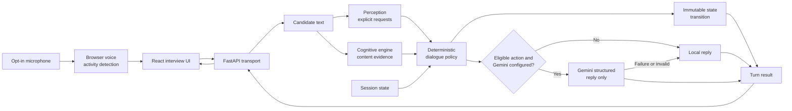

# Multimodal Reasoning Companion

A CPU-first adaptive interview-practice assistant built as an AI systems portfolio project. The project separates observable input processing, internal state, dialogue policy, and response generation so each decision can be tested without relying on one large model.

The current milestone is a **React interview interface with opt-in local audio turn-taking cues**, backed by a stateless FastAPI service with optional Gemini structured reply generation. Perception, state updates, and dialogue actions remain deterministic and fully testable offline; vision is not implemented.

## Research question

> Compared with a transcript-only assistant, can speech-activity and optional visual observations later improve when the assistant waits, offers a hint, or asks a follow-up without making unsupported claims about the user's mental state?

The text baseline establishes the control condition for that future comparison.

## Architecture



| Layer | Responsibility | Must not do |
|---|---|---|
| `perception` | Detect explicit requests for a hint, thinking time, or stopping | Infer emotion or choose the final action |
| `cognitive` | Extract narrow content evidence and apply state transitions | Generate dialogue or call an LLM |
| `reasoning` | Apply one documented policy, render local replies, and optionally request one structured Gemini reply | Allow Gemini to change an action, reason, or state |
| `service` | Orchestrate one turn in a fixed order and expose reply source/fallback metadata | Persist transcripts or duplicate policy rules |
| `api` | Validate HTTP requests and delegate one turn to `InterviewService` | Store sessions, duplicate policy, or expose internal errors |
| `frontend` | Keep the session in memory, derive local voice-activity turn cues, and display conversation evidence | Reimplement dialogue policy, persist media, transcribe audio, or infer psychological state |
| `eval` | Exercise the domain service directly in local mode | Start FastAPI, a browser, or Gemini |

Control precedence is:

```text
ended session > stop > thinking time > hint > missing input
> class-level follow-up > evaluation follow-up > continue
```

## Current behavior

The baseline supports six actions:

- `offer_hint`
- `wait`
- `ask_followup`
- `end_session`
- `continue_interview`
- `request_input`

Every turn returns the extracted signals, content evidence, selected action and reason, updated session state, reply, `reply_source`, and optional `fallback_reason`. `SessionState` contains counters and control state only; it does not retain candidate text. `wait`, `end_session`, and `request_input` are always rendered locally. Only `offer_hint`, `ask_followup`, and `continue_interview` are eligible for Gemini.

## Quickstart

Use official CPython 3.11 or newer and Node.js 22 or newer. Install and verify the backend from the repository root:

```powershell
py -3.14 -m venv .venv
.venv\Scripts\python -m pip install -r requirements-dev.txt
.venv\Scripts\python -m pytest -q
.venv\Scripts\python -m eval.run_cases
```

Start FastAPI in the first terminal:

```powershell
.venv\Scripts\python -m uvicorn backend.app.main:app --reload
```

Start React in a second terminal:

```powershell
cd frontend
npm install
npm test
npm run dev
```

Open `http://127.0.0.1:5173`. To use a different backend URL, copy `frontend/.env.example` to `frontend/.env` and change `VITE_API_BASE_URL`.

### Optional Gemini replies

The project uses the official `google-genai` SDK and defaults to the current stable low-latency model `gemini-3.8-flash`. Copy `.env.example` as a reference, then set variables in the process environment; the project does not silently load `.env` files.

```powershell
$env:GEMINI_API_KEY = "your-key"
$env:GEMINI_MODEL = "gemini-3.8-flash"
$env:GEMINI_TIMEOUT_SECONDS = "8"
```

The FastAPI composition root reads these variables when the server starts and constructs `InterviewService` once. No key keeps the API in local response mode.

An absent or blank key keeps local mode. Invalid timeout configuration fails at construction only when a key is present. Timeout, SDK error, malformed structured output, or invalid reply uses the exact local response and returns `reply_source="local_fallback"` with a machine-readable reason. There are no application-level retries.

Run backend commands from the repository root and npm commands from `frontend/`.

## Text API

The API is stateless. Clients send the current `SessionState` with every turn and receive the updated state in the response.

| Method | Path | Behavior |
|---|---|---|
| `GET` | `/health` | Returns `{\"status\":\"ok\"}` without invoking the model |
| `POST` | `/v1/interview/turn` | Runs one deterministic interview turn |
| `GET` | `/docs` | Interactive OpenAPI documentation |

Example request:

```bash
curl -X POST http://127.0.0.1:8000/v1/interview/turn \
  -H \"Content-Type: application/json\" \
  -d '{
    \"candidate_input\": \"I built a classifier for support tickets.\",
    \"state\": {\"session_id\": \"demo-session\"}
  }'
```

The response includes observable evidence, the local policy decision, updated state, reply, `reply_source`, and optional `fallback_reason`. Schema errors return HTTP `422`. Gemini failures still return HTTP `200` with the exact local reply and `reply_source=\"local_fallback\"`.

Browser access is restricted to the local Vite origins `http://localhost:5173` and `http://127.0.0.1:5173`.

## Text interview UI

The React client keeps session state and conversation history in memory only. It provides:

- a text interview flow across multiple turns;
- an evidence and deterministic policy decision monitor;
- visible `local`, `gemini`, and `local_fallback` reply sources;
- a reset action that discards the in-memory transcript and creates a new session;
- an explicit API connectivity error without exposing backend internals.

The UI does not infer or display stress, mood, focus, personality, or hiring suitability.

## Audio turn-taking v1

Audio perception is optional and runs entirely in the browser after the user clicks **Enable microphone**. The Web Audio API samples signal energy and derives these observable fields:

- microphone `availability`;
- whether any speech-like activity has been observed;
- whether activity is present now;
- cumulative speech-activity duration;
- trailing silence duration.

The local readiness policy distinguishes `speaking`, `listening`, `thinking_pause`, and `ready`. A pause shorter than 1.6 seconds remains `thinking_pause`; it does not mark the turn complete. The cue is advisory: it never submits text, changes a dialogue action, or overrides the manual **Send answer** control.

The browser does not record, transcribe, upload, or persist audio. Energy-based activity detection can react to environmental noise and must not be interpreted as emotion, focus, confusion, or speaking quality.

## Evaluation

### Dialogue smoke evaluation

`eval/cases.json` contains five initial interview scenarios:

1. explicit hint request;
2. explicit request for thinking time;
3. project description without evaluation evidence;
4. macro-F1 with class-imbalance rationale but no class-level result;
5. explicit request to end the session.

The runner creates a fresh session for each case and compares `action`, `reason`, and `followup_topic`. Human-facing `reply_criteria` remain in the fixture for later structured-output evaluation.

A successful run prints:

```text
PASS request_hint
PASS request_thinking_time
PASS project_without_evaluation
PASS metric_with_rationale
PASS request_end_session
Summary: 5 passed, 0 failed
```

It writes `eval/results/latest.json` with this shape:

```json
{
  "schema_version": "eval-v1",
  "summary": {
    "total": 5,
    "passed": 5,
    "failed": 0
  },
  "cases": [
    {
      "id": "request_hint",
      "expected": {
        "action": "offer_hint",
        "reason": "explicit_hint_request",
        "followup_topic": "none"
      },
      "actual": {
        "action": "offer_hint",
        "reason": "explicit_hint_request",
        "followup_topic": "none"
      },
      "reply": "Start by naming the metric you used and why it matched the problem.",
      "passed": true
    }
  ]
}
```

The five cases are a smoke evaluation, not evidence of robustness, scientific validity, multilingual performance, or generalization.

### Answer-quality benchmark

`eval/answer_quality_cases.json` defines six calibration and six held-out cases before a semantic evaluator is implemented. The contract labels observable answer properties (`input_type`, `relevance`, project evidence, evaluation-method evidence, and evaluation-result evidence) plus the expected policy action. It does not score intelligence, personality, employability, or speaking style.

The fixture covers missing input, irrelevant and vague answers, paraphrased evidence, a prompt-injection attempt, and explicit hint/thinking/stop controls. Case IDs are unique across splits, and held-out cases must not be used to tune prompts or heuristics.

```powershell
python -m eval.answer_quality_evaluation
```

The current deterministic keyword baseline is reported honestly:

| Split | Exact evidence + action | Expected action |
|---|---:|---:|
| Calibration | 4/6 (66.67%) | 5/6 (83.33%) |
| Held-out | 2/6 (33.33%) | 3/6 (50.00%) |

The future target is at least 80% held-out exact match and 100% held-out critical-action accuracy. The default runner validates the dataset, writes `eval/results/answer-quality-latest.json`, and reports `Target status: NOT MET` without failing CI. Use `--enforce-target` only after the semantic evaluator is connected; it currently exits non-zero by design.

Reports contain case IDs, labels, decisions, and aggregate metrics but omit candidate text. These authored cases are engineering fixtures, not evidence of human validity, multilingual performance, or generalization.

### Audio turn evaluation

`eval/audio_cases.json` contains separate synthetic `calibration` and `held_out` timing traces sampled at 100 ms. Calibration selects the threshold with the fewest false-ready cases, then the lowest mean end-detection delay. Held-out traces are never used for threshold selection.

```powershell
node --test eval/audio_evaluation.test.js
node eval/run_audio_cases.js
```

| Threshold | Calibration false-ready rate | Calibration mean delay | Held-out false-ready rate | Held-out mean delay |
|---:|---:|---:|---:|---:|
| 800 ms | 66.67% | 800 ms | 50% | 1,000 ms |
| 1,200 ms | 33.33% | 1,200 ms | 50% | 1,400 ms |
| **1,600 ms** | **0%** | **1,600 ms** | **25%** | **1,800 ms** |
| 2,000 ms | 0% | 2,000 ms | 0% | 2,200 ms |

The deterministic selection rule chooses 1,600 ms. On held-out traces it detects every completed turn, handles unavailable/no-speech cases correctly, and exposes one known failure: a candidate who resumes after a 1,700 ms thinking pause is marked ready 100 ms too early. The acceptance gate allows at most a 25% false-ready rate and 2,200 ms mean delay, so the current pilot passes without hiding that failed case.

The runner writes `eval/results/audio-latest.json`. These traces are synthetic engineering fixtures, not evidence of human conversational validity or cross-speaker generalization. A consented multi-speaker pilot is required before making portfolio performance claims.

## Privacy and scientific boundaries

- Candidate text is processed in memory and is not stored in `SessionState` or default logs.
- Gemini receives candidate text only when an API key is configured, the generator is explicitly injected, and the selected action is eligible. Review Google's data handling terms before using real interview content.
- Logs contain reply source and fallback reason only, not candidate text, prompts, response bodies, API keys, or exception messages.
- Raw audio is sampled in memory for voice activity only; it is not recorded, transcribed, uploaded, logged, or persisted.
- Microphone access requires an explicit button click and browser permission. Denial leaves the complete text workflow available.
- Missing audio is represented as `unavailable`, never as silence or a neutral psychological state.
- Text heuristics, audio energy, and future facial blendshapes do **not** measure stress, focus, mood, honesty, personality, competence, or hiring suitability.
- Vision has not been implemented. It remains an optional experiment that must demonstrate measurable value before inclusion.

Gemini generates wording only. Local policy retains ownership of `action`, `reason`, `followup_topic`, and all state transitions; control actions remain local even when Gemini is configured.
