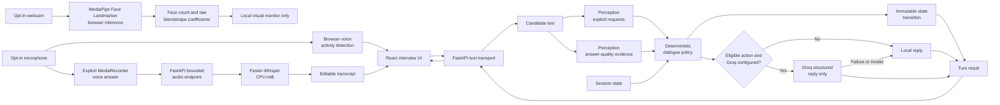

# Multimodal Reasoning Companion

A CPU-first adaptive interview-practice assistant built as an AI systems portfolio project. The project separates observable input processing, internal state, dialogue policy, and response generation so each decision can be tested without relying on one large model.

The current milestone is a **React interview interface with local Faster-Whisper speech-to-text, audio turn-taking cues, opt-in MediaPipe Face Landmarker observations, and explainable answer-quality evidence**, backed by a stateless FastAPI service with optional Groq reply generation. Dialogue policy and state updates remain deterministic and fully testable offline; visual observations remain local to the browser and do not influence policy.

## Research question

> Compared with a transcript-only assistant, can observable speech-activity and visual signals improve when the assistant waits, offers a hint, or asks a follow-up without making unsupported claims about the user's mental state?

The text baseline establishes the control condition for that future comparison.

## Architecture



| Layer | Responsibility | Must not do |
|---|---|---|
| `perception` | Detect explicit controls and answer evidence; transcribe explicit audio clips locally | Infer emotion, score the candidate, or choose the final action |
| `cognitive` | Apply immutable session-state transitions | Extract evidence, generate dialogue, or call a model |
| `reasoning` | Apply one documented policy, render local replies, and optionally request one structured Groq reply | Allow Groq to change an action, reason, or state |
| `service` | Orchestrate one text turn and expose reply source/fallback metadata | Persist transcripts or duplicate policy rules |
| `api` | Validate text requests and bounded audio streams, then delegate to the correct local component | Store sessions or media, duplicate policy, or expose internal errors |
| `frontend` | Keep the session in memory, derive voice-activity cues, record explicit voice answers, and run opt-in Face Landmarker inference locally | Auto-submit transcripts, upload or persist camera frames, infer psychological state, or let visual observations change policy |
| `eval` | Exercise deterministic domain and timing behavior | Start Groq or claim human validity from fixtures |

Control and answer precedence is:

```text
ended session > stop > thinking time > hint > missing input
> irrelevant/unclear answer > class-level follow-up
> missing project > missing evaluation > continue
```

## Current behavior

The baseline supports seven actions:

- `offer_hint`
- `wait`
- `ask_followup`
- `end_session`
- `continue_interview`
- `request_input`
- `request_clarification`

Every turn returns explicit signals; input type; answer relevance; project, evaluation-method, and evaluation-result evidence; the selected action and reason; updated session state; reply; `reply_source`; and optional `fallback_reason`. `SessionState` contains counters and control state only; it does not retain candidate text.

The evidence extractor uses documented, precompiled lexical patterns rather than claiming general language understanding. It identifies concrete project descriptions, evaluation terminology, numeric results, and explicit controls. Irrelevant or unclear answers receive `request_clarification`. `wait`, `end_session`, and `request_input` are always rendered locally. `offer_hint`, `ask_followup`, `continue_interview`, and `request_clarification` are eligible for optional Groq wording.

## Quickstart

Use official CPython 3.11 or newer and Node.js 22 or newer. Install and verify the backend from the repository root:

```powershell
py -3.14 -m venv .venv
.venv\Scripts\python -m pip install -r requirements-dev.txt
.venv\Scripts\python -m pip install -r backend/requirements-stt.txt
.venv\Scripts\python -m pytest -q
.venv\Scripts\python -m eval.run_cases
.venv\Scripts\python -m eval.answer_quality_evaluation --enforce-target
```

Start FastAPI in the first terminal:

```powershell
.venv\Scripts\python -m uvicorn backend.app.main:app --reload
```

Start React in a second terminal:

```powershell
cd frontend
npm install
npm test
npm run dev
```

Open `http://127.0.0.1:5173`. To use a different backend URL, copy `frontend/.env.example` to `frontend/.env` and change `VITE_API_BASE_URL`.

Camera perception is optional. The browser downloads the versioned Face Landmarker model from Google on first use; the MediaPipe 1.2.3 runtime and Wasm are bundled by Vite.

### Local speech-to-text

`backend/requirements-stt.txt` installs Faster-Whisper 1.2.1 and pins PyAV below 19 because that Faster-Whisper release still calls the pre-19 `av.open` API. Defaults are CPU `int8`, English `base.en`, and a 60-second decoded-audio limit:

```powershell
$env:WHISPER_MODEL = "base.en"
$env:WHISPER_DEVICE = "cpu"
$env:WHISPER_COMPUTE_TYPE = "int8"
$env:WHISPER_LANGUAGE = "en"
$env:WHISPER_MAX_AUDIO_SECONDS = "60"
```

The first transcription downloads model weights from Hugging Face and loads them lazily. Later requests use the local cache. Model weights may persist in the Hugging Face cache; candidate audio does not. The project reads process environment variables and does not silently load `.env`.

### Optional Groq replies

The project uses the official `groq` Python SDK and defaults to the production `openai/gpt-oss-20b` model for low-latency wording with strict JSON Schema output. `openai/gpt-oss-120b` is the supported higher-capacity alternative. Copy `.env.example` as a reference, then set variables in the process environment; the project does not silently load `.env` files.

```powershell
$env:GROQ_API_KEY = "your-new-key"
$env:GROQ_MODEL = "openai/gpt-oss-20b"
$env:GROQ_TIMEOUT_SECONDS = "8"
```

The FastAPI composition root reads these variables when the server starts and constructs `InterviewService` once. No key keeps the API in local response mode. Store keys only in the process environment or an ignored local secret file; never commit or paste a real key into issues, chat, screenshots, or logs. Revoke any key that has been exposed.

The application intentionally does not route requests across every Groq model. One production model per request keeps behavior, latency, cost, and evaluation reproducible. Only the two GPT-OSS models above are accepted because Groq documents strict structured-output support for them. Faster-Whisper and MediaPipe remain local rather than being replaced with hosted audio or vision models, preserving the modular, privacy-first architecture.

An absent or blank key keeps local mode. Invalid timeout or model configuration fails at construction only when a key is present. Timeout, SDK error, malformed structured output, or invalid reply uses the exact local response and returns `reply_source="local_fallback"` with a machine-readable reason. The SDK is configured with retries disabled.

Run backend commands from the repository root and npm commands from `frontend/`.

## Text API

The API is stateless. Clients send the current `SessionState` with every turn and receive the updated state in the response.

| Method | Path | Behavior |
|---|---|---|
| `GET` | `/health` | Returns `{\"status\":\"ok\"}` without invoking the model |
| `POST` | `/v1/interview/turn` | Runs one deterministic interview turn |
| `POST` | `/v1/audio/transcriptions` | Transcribes a bounded raw WebM, Ogg, MP4, FLAC, or WAV body locally |
| `GET` | `/docs` | Interactive OpenAPI documentation |

Example request:

```bash
curl -X POST http://127.0.0.1:8000/v1/interview/turn \
  -H \"Content-Type: application/json\" \
  -d '{
    \"candidate_input\": \"I built a classifier for support tickets.\",
    \"state\": {\"session_id\": \"demo-session\"}
  }'
```

The response includes observable evidence, the local policy decision, updated state, reply, `reply_source`, and optional `fallback_reason`. Schema errors return HTTP `422`. Groq failures still return HTTP `200` with the exact local reply and `reply_source=\"local_fallback\"`.

Browser access is restricted to the local Vite origins `http://localhost:5173` and `http://127.0.0.1:5173`.

## Text interview UI

The React client keeps session state and conversation history in memory only. It provides:

- a text interview flow across multiple turns;
- an evidence and deterministic policy decision monitor;
- visible `local`, `groq`, and `local_fallback` reply sources;
- explicit voice recording that appends a local transcript to the editable answer;
- opt-in browser-only face landmarks with face count, inference latency, and the three strongest raw blendshape coefficients;
- a reset action that stops active sensors, discards the in-memory transcript, and creates a new session;
- an explicit API connectivity error without exposing backend internals.

The UI does not infer or display stress, mood, focus, personality, or hiring suitability.

## Audio turn-taking and local speech-to-text

Audio remains optional and starts only after **Enable microphone**. The Web Audio API continuously derives observable voice-activity timing in the browser: microphone availability, current speech-like activity, cumulative speech duration, and trailing silence. It does not retain those samples.

The readiness policy distinguishes `speaking`, `listening`, `thinking_pause`, and `ready`. A pause shorter than 1.6 seconds remains `thinking_pause`. This timing cue never submits text or changes a dialogue action.

Speech-to-text is a separate, explicit path:

1. **Start voice answer** starts `MediaRecorder` on the already-consented microphone stream.
2. **Stop and transcribe** sends the clip only to `127.0.0.1` FastAPI.
3. FastAPI accepts WebM, Ogg, MP4, FLAC, or WAV; rejects bodies above 10 MiB; and keeps accepted bytes in an in-memory stream.
4. Faster-Whisper decodes the clip, rejects decoded audio above 60 seconds, and transcribes with CPU `int8` by default.
5. The transcript is appended to **Your answer** for review and editing. Only **Send answer** starts an interview turn.

The backend serializes model inference to avoid concurrent CPU and memory spikes. Errors such as unsupported media, silence, missing runtime, or model failure are returned as safe status messages; text input remains available.

## Local visual perception

**Enable camera** requests browser camera permission and starts MediaPipe Face Landmarker in `VIDEO` mode at no more than five inferences per second. The application reports only directly observable outputs: model availability, face count, inference latency, and up to three raw blendshape coefficients when exactly one face is visible. Coefficients are suppressed for multiple faces to avoid ambiguous attribution.

All frame processing occurs in the browser. Frames, landmarks, and coefficients are not sent to FastAPI, Groq, storage, or application logs. **Stop camera**, **Reset session**, and component unmount stop every camera track and close the Face Landmarker runtime. Camera denial, missing hardware, model-loading failure, or inference failure leaves text and audio available.

This baseline deliberately does not map facial movement to mood, stress, focus, honesty, competence, or hiring suitability. Visual observations are displayed for system transparency but do not change the dialogue policy. A separate held-out vision benchmark is required before testing any multimodal policy rule.

## Evaluation

### Dialogue smoke evaluation

`eval/cases.json` contains five initial interview scenarios:

1. explicit hint request;
2. explicit request for thinking time;
3. project description without evaluation evidence;
4. macro-F1 with class-imbalance rationale but no class-level result;
5. explicit request to end the session.

The runner creates a fresh session for each case and compares `action`, `reason`, and `followup_topic`. Human-facing `reply_criteria` remain in the fixture for later structured-output evaluation.

A successful run prints:

```text
PASS request_hint
PASS request_thinking_time
PASS project_without_evaluation
PASS metric_with_rationale
PASS request_end_session
Summary: 5 passed, 0 failed
```

It writes `eval/results/latest.json` with this shape:

```json
{
  "schema_version": "eval-v1",
  "summary": {
    "total": 5,
    "passed": 5,
    "failed": 0
  },
  "cases": [
    {
      "id": "request_hint",
      "expected": {
        "action": "offer_hint",
        "reason": "explicit_hint_request",
        "followup_topic": "none"
      },
      "actual": {
        "action": "offer_hint",
        "reason": "explicit_hint_request",
        "followup_topic": "none"
      },
      "reply": "Start by naming the metric you used and why it matched the problem.",
      "passed": true
    }
  ]
}
```

The five cases are a smoke evaluation, not evidence of robustness, scientific validity, multilingual performance, or generalization.

### Answer-quality benchmark

`eval/answer_quality_cases.json` defines six calibration and six held-out cases. The contract labels observable answer properties (`input_type`, `relevance`, project evidence, evaluation-method evidence, and evaluation-result evidence) plus the expected policy action. It does not score intelligence, personality, employability, or speaking style.

The fixture covers missing input, irrelevant and vague answers, paraphrased evidence, a prompt-injection attempt, and explicit hint/thinking/stop controls. Case IDs are unique across splits. The held-out cases were fixed before this evaluator and were not changed while implementing it.

```powershell
python -m eval.answer_quality_evaluation --enforce-target
```

The explainable deterministic evaluator produces:

| Split | Exact evidence + action | Expected action |
|---|---:|---:|
| Calibration | 6/6 (100%) | 6/6 (100%) |
| Held-out | 6/6 (100%) | 6/6 (100%) |

The acceptance target is at least 80% held-out exact match and 100% held-out critical-action accuracy. CI now enforces that target. The runner writes `eval/results/answer-quality-latest.json`; reports contain case IDs, labels, decisions, and aggregate metrics but omit candidate text.

Twelve authored cases are only deterministic regression fixtures. The perfect result is not evidence of human validity, multilingual performance, broad semantic understanding, or generalization. A larger independently labeled dataset is required before making those claims.

### Audio turn evaluation

`eval/audio_cases.json` contains separate synthetic `calibration` and `held_out` timing traces sampled at 100 ms. Calibration selects the threshold with the fewest false-ready cases, then the lowest mean end-detection delay. Held-out traces are never used for threshold selection.

```powershell
node --test eval/audio_evaluation.test.js
node eval/run_audio_cases.js
```

| Threshold | Calibration false-ready rate | Calibration mean delay | Held-out false-ready rate | Held-out mean delay |
|---:|---:|---:|---:|---:|
| 800 ms | 66.67% | 800 ms | 50% | 1,000 ms |
| 1,200 ms | 33.33% | 1,200 ms | 50% | 1,400 ms |
| **1,600 ms** | **0%** | **1,600 ms** | **25%** | **1,800 ms** |
| 2,000 ms | 0% | 2,000 ms | 0% | 2,200 ms |

The deterministic selection rule chooses 1,600 ms. On held-out traces it detects every completed turn, handles unavailable/no-speech cases correctly, and exposes one known failure: a candidate who resumes after a 1,700 ms thinking pause is marked ready 100 ms too early. The acceptance gate allows at most a 25% false-ready rate and 2,200 ms mean delay, so the current pilot passes without hiding that failed case.

The runner writes `eval/results/audio-latest.json`. These traces are synthetic engineering fixtures, not evidence of human conversational validity or cross-speaker generalization. A consented multi-speaker pilot is required before making portfolio performance claims.

### Local STT benchmark

`eval/stt_cases.json` pins two public Faster-Whisper test assets to upstream commit `6cb639e70786aea42b9233006ae60eaf07190bdb`, exact byte sizes, and SHA-256 hashes. Assets are downloaded into ignored `eval/cache/stt/`; this repository does not redistribute them. One JFK speaker is calibration data. Two distinct mono reader channels from the stereo fixture are held out, so speaker IDs do not cross splits.

```powershell
# Contract and speaker-split validation only; no model or audio download
python -m eval.run_stt_cases --validate-only

# Report-only real benchmark
python -m eval.run_stt_cases

# Fail when the fixed held-out target is missed
python -m eval.run_stt_cases --enforce-target
```

Transcript normalization applies Unicode NFKC, case folding, punctuation removal, and whitespace collapse. Word Error Rate is `(substitutions + deletions + insertions) / reference words`. Real-Time Factor is `processing duration / audio duration`; values below `1.0` are faster than real time. Failed cases count all reference words as errors, so failures cannot disappear from aggregate WER.

The target was fixed before the first held-out run: 100% held-out success, corpus WER at most 0.20, and mean warm RTF at most 1.0. The observed `base.en`, CPU `int8`, Python 3.14 baseline on this Windows AMD64 workstation was:

| Split/case | Audio | Processing | WER | RTF |
|---|---:|---:|---:|---:|
| Calibration JFK, first request including model acquisition/loading | 11,000 ms | 21,182 ms | 0.0000 | 1.9256 |
| Held-out left reader, warm | 5,000 ms | 646 ms | 0.0000 | 0.1292 |
| Held-out right reader, warm | 5,000 ms | 597 ms | 0.0000 | 0.1194 |
| **Held-out aggregate** | — | **622 ms mean** | **0.0000 corpus** | **0.1243 mean** |

Target status: **PASS**. The runner writes `eval/results/stt-latest.json` with hypotheses, per-case metrics, runtime metadata, and safe failure categories.

Three clean English public fixtures are integration evidence only. They do not establish performance on interview answers, microphones, accents, background noise, multilingual speech, or unseen datasets. A larger consented speaker-disjoint corpus is required before publishing portfolio accuracy claims.

## Privacy and scientific boundaries

- Candidate text is processed in memory and is not stored in `SessionState` or default logs.
- Groq receives candidate text only when an API key is configured and the selected action is eligible. Review Groq's data handling terms before using real interview content.
- Logs contain reply source and fallback reason only, not candidate text, prompts, response bodies, API keys, audio, or exception messages.
- Voice-activity samples remain in browser memory and are never recorded by the timing path.
- Voice-answer recording requires a separate explicit click. The clip is sent only to local FastAPI, bounded by size and decoded duration, processed in memory, and not persisted.
- Microphone denial or transcription failure leaves the complete text workflow available.
- Missing audio is represented as `unavailable`, never as silence or a neutral psychological state.
- Text heuristics, audio energy, transcripts, and facial blendshapes do **not** measure stress, focus, mood, honesty, personality, competence, or hiring suitability.
- Camera use is opt-in. Frames remain in browser memory, are never uploaded or persisted, and have no effect on dialogue policy; model acquisition still requires a network request to Google's versioned model asset.

Groq generates wording only. Local policy retains ownership of `action`, `reason`, `followup_topic`, and all state transitions; control actions remain local even when Groq is configured.
