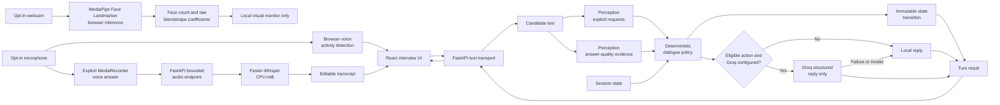

# Multimodal Reasoning Companion

A CPU-first adaptive interview-practice assistant built as an AI systems portfolio project. The project separates observable input processing, internal state, dialogue policy, and response generation so each decision can be tested without relying on one large model.

The current milestone is a **React interview interface with local Faster-Whisper speech-to-text, audio turn-taking cues, opt-in MediaPipe Face Landmarker observations, and explainable answer-quality evidence**, backed by a stateless FastAPI service. Groq drives the conversation using the CV, job description, and dialogue history. Turn-taking stays deterministic and testable offline: audio readiness and one confident facial high-load signal can change the selected action, and both are measured in `eval/run_multimodal_ab.py`.

**Start here for the results:** [`docs/technical-brief.md`](docs/technical-brief.md) — research question, architecture, measured results, and stated limitations on one page.

## Research question

> Compared with a transcript-only assistant, can observable speech-activity and visual signals improve when the assistant waits, offers a hint, or asks a follow-up without making unsupported claims about the user's mental state?

The text baseline is the control condition; `eval/run_multimodal_ab.py` compares it against text+audio and text+audio+visual on identical inputs.

## Architecture



| Layer | Responsibility | Must not do |
|---|---|---|
| `perception` | Detect explicit controls and answer evidence; transcribe explicit audio clips locally | Infer emotion, score the candidate, or choose the final action |
| `cognitive` | Apply immutable session-state transitions | Extract evidence, generate dialogue, or call a model |
| `reasoning` | Apply one documented policy, render local replies, and optionally request one structured Groq reply | Allow Groq to change an action, reason, or state |
| `service` | Orchestrate one text turn and expose reply source/fallback metadata | Persist transcripts or duplicate policy rules |
| `api` | Validate text requests and bounded audio streams, then delegate to the correct local component | Store sessions or media, duplicate policy, or expose internal errors |
| `frontend` | Keep the session in memory, derive voice-activity cues, record explicit voice answers, and run opt-in Face Landmarker inference locally | Auto-submit transcripts, upload or persist camera frames, infer psychological state, or let visual observations change policy |
| `eval` | Exercise deterministic domain and timing behavior | Start Groq or claim human validity from fixtures |

Control and answer precedence is:

```text
ended session > stop > thinking time > hint > missing input
> irrelevant/unclear answer > class-level follow-up
> missing project > missing evaluation > continue
```

## Current behavior

The baseline supports seven actions:

- `offer_hint`
- `wait`
- `ask_followup`
- `end_session`
- `continue_interview`
- `request_input`
- `request_clarification`

Every turn returns explicit signals; input type; answer relevance; project, evaluation-method, and evaluation-result evidence; the selected action and reason; updated session state; reply; `reply_source`; and optional `fallback_reason`. `SessionState` contains counters and control state only; it does not retain candidate text.

The evidence extractor uses documented, precompiled lexical patterns rather than claiming general language understanding. It identifies concrete project descriptions, evaluation terminology, numeric results, and explicit controls. Irrelevant or unclear answers receive `request_clarification`. `wait`, `end_session`, and `request_input` are always rendered locally. `offer_hint`, `ask_followup`, `continue_interview`, and `request_clarification` are eligible for optional Groq wording.

## Quickstart

Use official CPython 3.11 or newer and Node.js 22 or newer. Install and verify the backend from the repository root:

```powershell
py -3.14 -m venv .venv
.venv\Scripts\python -m pip install -r requirements-dev.txt
.venv\Scripts\python -m pip install -r backend/requirements-stt.txt
.venv\Scripts\python -m pytest -q
.venv\Scripts\python -m eval.run_cases
.venv\Scripts\python -m eval.answer_quality_evaluation --enforce-target
```

Start FastAPI in the first terminal:

```powershell
.venv\Scripts\python -m uvicorn backend.app.main:app --reload
```

Start React in a second terminal:

```powershell
cd frontend
npm install
npm test
npm run dev
```

Open `http://127.0.0.1:5173`. To use a different backend URL, copy `frontend/.env.example` to `frontend/.env` and change `VITE_API_BASE_URL`.

Camera perception is optional. The browser downloads the versioned Face Landmarker model from Google on first use; the MediaPipe 1.2.3 runtime and Wasm are bundled by Vite.

### Speech-to-text

The project supports two STT providers selected by `STT_PROVIDER`:

| Provider | Model | Audio stays on device? | Requires API key? |
|----------|-------|----------------------|-------------------|
| `local` (default) | Faster-Whisper `small` multilingual | Yes | No |
| `groq` | Groq Whisper `whisper-large-v3-turbo` or `whisper-large-v3` | No — uploaded to Groq | Yes (`GROQ_API_KEY`) |

When `STT_PROVIDER=groq` is set but `GROQ_API_KEY` is empty, the backend falls back to local Faster-Whisper with a warning rather than crashing.

**Local configuration** (`backend/requirements-stt.txt` installs Faster-Whisper 1.2.1):

```powershell
$env:STT_PROVIDER = "local"
$env:WHISPER_MODEL = "small"
$env:WHISPER_DEVICE = "cpu"
$env:WHISPER_COMPUTE_TYPE = "int8"
$env:WHISPER_LANGUAGE = "auto"
$env:WHISPER_MAX_AUDIO_SECONDS = "60"
```

**Groq configuration:**

```powershell
$env:STT_PROVIDER = "groq"
$env:GROQ_API_KEY = "your-key"
$env:GROQ_STT_MODEL = "whisper-large-v3-turbo"
$env:GROQ_STT_LANGUAGE = "auto"
$env:GROQ_STT_TIMEOUT_SECONDS = "30"
```

`whisper-large-v3-turbo` is faster and cheaper ($0.04/hour) but has a higher documented WER (12%). `whisper-large-v3` is more accurate (WER 10.3%) but slower ($0.111/hour). Both support multilingual transcription.

Groq free tier accepts files up to 25 MiB and bills a minimum of 10 seconds per request. Audio is uploaded to `api.groq.com`; transcript and language metadata are returned. `create_app()` loads a repo-root `.env` file at startup through `backend/app/env_loader.py`; variables already set in the process environment take precedence.

Local Faster-Whisper downloads model weights from Hugging Face on first use and loads them lazily. Later requests use the local cache. Model weights may persist in the Hugging Face cache; candidate audio does not.

`WHISPER_LANGUAGE=auto` lets the multilingual model detect each clip. Set it to `en` or `id` to pin English or Indonesian when short or noisy recordings are misdetected. The pinned `base.en` evaluation below remains a historical English baseline and is not relabeled as evidence for `small`.

### Optional Groq replies

The project uses the official `groq` Python SDK and defaults to the production `openai/gpt-oss-20b` model for low-latency wording with strict JSON Schema output. `openai/gpt-oss-120b` is the supported higher-capacity alternative. Copy `.env.example` to `.env` and fill in `GROQ_API_KEY`; the backend loads it at startup with no third-party dependency. Exported shell variables override the file.

```powershell
$env:GROQ_API_KEY = "your-new-key"
$env:GROQ_MODEL = "openai/gpt-oss-20b"
$env:GROQ_TIMEOUT_SECONDS = "8"
```

The FastAPI composition root reads these variables when the server starts and constructs `InterviewService` once. No key keeps the API in local response mode. Store keys only in the process environment or an ignored local secret file; never commit or paste a real key into issues, chat, screenshots, or logs. Revoke any key that has been exposed.

The application intentionally does not route requests across every Groq model. One production model per request keeps behavior, latency, cost, and evaluation reproducible. Only the two GPT-OSS models above are accepted because Groq documents strict structured-output support for them. Faster-Whisper and MediaPipe remain local rather than being replaced with hosted audio or vision models, preserving the modular, privacy-first architecture.

An absent or blank key keeps local mode. Invalid timeout or model configuration fails at construction only when a key is present. Timeout, SDK error, malformed structured output, or invalid reply uses the exact local response and returns `reply_source="local_fallback"` with a machine-readable reason. The SDK is configured with retries disabled.

Run backend commands from the repository root and npm commands from `frontend/`.

## Text API

The API is stateless. Clients send the current `SessionState` with every turn and receive the updated state in the response.

| Method | Path | Behavior |
|---|---|---|
| `GET` | `/health` | Returns `{\"status\":\"ok\"}` without invoking the model |
| `POST` | `/v1/interview/turn` | Runs one deterministic interview turn |
| `POST` | `/v1/audio/transcriptions` | Transcribes a bounded raw WebM, Ogg, MP4, FLAC, or WAV body locally |
| `GET` | `/docs` | Interactive OpenAPI documentation |

Example request:

```bash
curl -X POST http://127.0.0.1:8000/v1/interview/turn \
  -H \"Content-Type: application/json\" \
  -d '{
    \"candidate_input\": \"I built a classifier for support tickets.\",
    \"state\": {\"session_id\": \"demo-session\"}
  }'
```

The response includes observable evidence, the local policy decision, updated state, reply, `reply_source`, and optional `fallback_reason`. Schema errors return HTTP `422`. Groq failures still return HTTP `200` with the exact local reply and `reply_source=\"local_fallback\"`.

Browser access is restricted to the local Vite origins `http://localhost:5173` and `http://127.0.0.1:5173`.

## Text interview UI

The React client keeps session state and conversation history in memory only.

The responsive dashboard separates the workflow into three views:

- **Practice room:** conversation, editable answer, opening generation, and
  optional camera/voice controls.
- **Application context:** target role, job posting, CV upload, and Strict/Coach
  selection. Generate an opening here to return to practice with that context.
- **Session insights:** review (available after two turns) and the decision,
  evidence, and session-state monitor.

Navigation preserves drafts, conversation, and sensor streams. Sensor status
remains visible in the header; use the practice controls to stop sensors, or
**New session** to stop them and clear context, chat, and the previous review.
Chat auto-scroll is contained inside the conversation, not the whole page.

**Opening lifecycle:** generate or regenerate the opening only before submitting
the first answer. Both opening buttons lock as soon as an answer is submitted,
including while it is pending or if sending fails, so visible history is never
given a different opening underneath it. Use **New session** to unlock them.
Typing a draft alone does not lock opening generation. If generating an opening
fails before any answer, it can be retried without losing the draft.

While opening generation is pending, sending/recording a new answer and both
reset controls are disabled. The opening endpoint itself remains a stateless
question generator; the dashboard owns this session-lifecycle safeguard.

Run `npm --prefix frontend run test:opening` for the isolated Chrome regression
(also run in CI). It starts its own Vite server and browser, controls API
responses without calling FastAPI/Groq, and exercises pending/failure, pre-answer
regeneration, active-session locks, and explicit reset. Install Chrome or set
`CHROME_PATH` / `PUPPETEER_EXECUTABLE_PATH`, as with the vision benchmark runner.

Available controls include:

- a text interview flow across multiple turns;
- an evidence and deterministic policy decision monitor;
- visible `local`, `groq`, and `local_fallback` reply sources;
- explicit voice recording that appends a local transcript to the editable answer;
- opt-in browser-only face landmarks with face count, inference latency, and the three strongest raw blendshape coefficients;
- a reset action that stops active sensors, discards the in-memory transcript, and creates a new session;
- an explicit API connectivity error without exposing backend internals.

The UI does not infer or display stress, mood, focus, personality, or hiring suitability.

## Audio turn-taking and local speech-to-text

Audio remains optional and starts only after **Enable microphone**. The Web Audio API continuously derives observable voice-activity timing in the browser: microphone availability, current speech-like activity, cumulative speech duration, and trailing silence. It does not retain those samples.

The readiness policy distinguishes `speaking`, `listening`, `thinking_pause`, and `ready`. A pause shorter than 1.6 seconds remains `thinking_pause`. This timing cue never submits text or changes a dialogue action.

Speech-to-text is a separate, explicit path:

1. **Start voice answer** starts `MediaRecorder` on the already-consented microphone stream.
2. **Stop and transcribe** sends the completed clip only to `127.0.0.1` FastAPI.
3. FastAPI accepts WebM, Ogg, MP4, FLAC, or WAV; rejects bodies above 10 MiB; and keeps accepted bytes in an in-memory stream.
4. Faster-Whisper decodes the clip, rejects decoded audio above 60 seconds, automatically detects English or Indonesian, and transcribes with CPU `int8` by default.
5. The transcript and detected language are shown locally; the transcript is appended to **Your answer** for review and editing. Only **Send answer** starts an interview turn.

The backend serializes model inference to avoid concurrent CPU and memory spikes. Errors such as unsupported media, silence, missing runtime, or model failure are returned as safe status messages; text input remains available.

This endpoint is clip-based rather than streaming: no audio is uploaded until recording stops. Near-real-time partial transcripts would require a separate WebSocket/chunking protocol, incremental decoding, cancellation, and backpressure; it is not simulated by repeatedly calling the batch endpoint.

## Local visual perception

**Enable camera** requests browser camera permission and starts MediaPipe Face Landmarker in `VIDEO` mode at no more than five inferences per second. The application reports model availability, face count, inference latency, up to five raw blendshape coefficients, and a proxy emotional state when exactly one face is visible. Coefficients and emotional state are suppressed for multiple faces to avoid ambiguous attribution.

Blendshape coefficients are sent to the local FastAPI backend once per second for FACS proxy mapping. Frames themselves are not uploaded; only the 52 blendshape values (name and score) are transmitted. The backend maps them to FACS action unit proxies following Ekman & Friesen (1978) documented AU-emotion combinations and returns a dominant emotion label with confidence.

All frame processing occurs in the browser. Frames are not sent to FastAPI, Groq, storage, or application logs. Blendshape coefficients are sent only to the local backend and are not persisted. **Stop camera**, **Reset session**, and component unmount stop every camera track and close the Face Landmarker runtime. Camera denial, missing hardware, model-loading failure, or inference failure leaves text and audio available.

The emotional state is attached to `SessionState`, read by the deterministic dialogue policy, and provided to the Groq LLM as advisory context.

**The policy now acts on one facial signal.** When the reading is a confident high-arousal emotion (`angry`, `fearful`, `disgusted` with confidence >= 0.35) and the alternative would add pressure, the policy returns `give_space` instead of another question. Constraints:

- explicit requests always win — a hint request still gets a hint;
- it fires at most once per session (`give_space_offered`);
- neutral, happy, low-confidence, and no-face readings never change the action.

Everything else stays advisory to the LLM as an explicit non-measurement note. The LLM is instructed to adjust tone subtly if appropriate but never to state that the candidate is stressed, confused, or emotional. The dialogue policy remains deterministic; emotional state does not change the action selected.

### Interview conversation and CV context

Groq drives the interview conversation. Each turn it receives the dialogue so
far, the uploaded CV text, the target role, and the advisory facial-expression
signal, then chooses both what to ask and how to phrase it.

Two things stay deterministic and outside the model:

- **Ending the session.** Only an explicit candidate request can end it.
- **Control intents.** Stop, wait, and meta questions are answered from fixed
  local text so a model cannot reinterpret them.

Provide context from the UI panel:

- **Target role** — free text, e.g. `Flutter Developer` or `Sales Associate`.
- **Job description** — paste the posting (max 8,000 characters). The active
  role and posting define the interview, not the subject of a past CV project.
  Questions probe relevant experience; requirements absent from the CV can be
  explored as knowledge or hypothetical situations, never invented experience.
- **CV** — upload `.pdf`, `.docx`, `.txt`, or `.md` (max 5 MiB). The backend extracts plain text and returns it to the browser; the
browser stores it in the session and sends it with later turns. **No CV text is
persisted on the server.** Scanned PDFs without a text layer are rejected with a
clear error because they need OCR first.

Removing the CV or clearing the role/job-description inputs removes that active
context from subsequent chat and review requests immediately, even before another
answer is submitted. It does not erase earlier chat messages or information
already sent to Groq; use **New session** to clear the whole browser session.
Requests already in progress retain the context they started with.

For `/v1/interview/turn`, omitted context fields preserve their values in `state`.
Explicit `null`, empty strings, or whitespace-only strings clear `cv_text`,
`target_role`, or `job_description`; clearing `cv_text` also clears `cv_filename`.

The initial question and offline replies are role-neutral. Without a role in the
context fields or an explicit candidate statement, Groq asks which role to
practice rather than assuming AI/ML. Strict/Coach and multimodal control rules
are unchanged.

**Interviewer style** (in the same panel):

- **Strict** is the default: one question without commentary.
- **Coach** requests at most one short observation grounded in the candidate's
  answer, followed by one question. It still does not write answers for the
  candidate or invent achievements.

The choice applies to generated openings and subsequent Groq replies. Switching
styles preserves conversation, CV, job description, and multimodal context.
Reset returns to Strict. Local control replies and offline fallbacks are
unchanged; this is a prompt preference, not a guarantee about model wording.
API clients can send `interview_mode: "strict" | "coach"` with
`/v1/interview/opening` or `/v1/interview/turn`. Turn state retains the mode when
the next request omits it; unknown values return 422.

If no `GROQ_API_KEY` is configured, the app falls back to the deterministic
text pipeline and says so in the transparency panel.

### Session review

`POST /v1/interview/review` summarizes a finished practice session. The output
splits facts from advice on purpose:

| Field | Source | Interpretation |
|---|---|---|
| `covered` | accumulated lexical evidence booleans | general answer cues detected, not verified skills |
| `missing` | the same booleans, inverted | not detected yet, not proof of missing experience |
| `suggestions` | Groq prose grounded in role, JD, CV, and answers | role-specific advice, not a competence score |
| `questions_to_ask` | Groq prose from the interview context | suggested questions, not factual findings |

Coverage uses only three general cues: **a specific work example**, **how the
work was checked**, and **a concrete outcome**. It never automatically demands
macro-F1, class imbalance, or per-class results. Those remain observable ML
detail flags, while technical advice uses the actual job and discussed task.

The extractor recognizes finite English/Indonesian phrases, testing and customer
feedback cues, percentages, score-context numbers, and timed improvements.
Unusual wording, negation, and implicit/qualitative outcomes can be missed or
misread. Bare version numbers, years, and identifiers are not outcome evidence.
The existing 12-case ML-focused benchmark is a regression check, not evidence
of general job-role coverage or real-world interview-assessment accuracy.

Without a configured reviewer, `review_source=local`. If a Groq request fails,
`review_source=local_fallback` includes `fallback_reason`. In both cases,
`covered` and `missing` are unchanged and local suggestions come from `missing`.

The UI distinguishes local mode from a failed cloud review and explains:

| Reason | Meaning |
|---|---|
| `timeout` | Groq did not finish within the configured request deadline |
| `sdk_error` | The provider request failed; inspect the backend log's exception type and HTTP status, if available |
| `malformed_output` | The response could not be parsed as the review schema |

For SDK errors, backend warnings record only the exception class and HTTP status
(for example, 401 for authentication, 429 for rate limits, or 5xx for provider
errors). Other warnings record the reason only. They never log exception messages,
response bodies, CV text, prompts, chat text, or API keys. The existing review
button allows a manual retry; no automatic retries or source relabelling are used.

The **Review this session** button is enabled after two turns. The UI labels
the lists **Observed answer cues** and **Not detected yet**, separating these
limited observations from Groq's role-specific advice.

### Multimodal A/B evaluation

`python -m eval.run_multimodal_ab` runs ten fixed scenarios under three
conditions over identical inputs:

| Condition | Audio turn-readiness | Facial high-load |
|---|---|---|
| `text` | withheld | withheld |
| `text_audio` | available | withheld |
| `text_audio_visual` | available | available |

Results (`eval/results/multimodal-ab-latest.json`):

| Scenario | text | text+audio | text+audio+visual |
|---|---|---|---|
| complete answer, calm | `continue_interview` | `continue_interview` | `continue_interview` |
| complete answer, tense face | `continue_interview` | `continue_interview` | **`give_space`** |
| thin answer, mid-speech pause | `request_clarification` | **`wait`** | `wait` |
| thin answer, turn ready | `request_clarification` | `request_clarification` | `request_clarification` |
| vague answer, still speaking | `request_clarification` | **`wait`** | `wait` |
| project only, tense face | `ask_followup` | `ask_followup` | **`give_space`** |
| project only, calm | `ask_followup` | `ask_followup` | `ask_followup` |
| nothing spoken | `request_input` | **`wait`** | `wait` |
| pause but answer complete | `continue_interview` | **`wait`** | `wait` |
| low-confidence face | `continue_interview` | `continue_interview` | `continue_interview` |

Audio changed the action in **4 of 10** scenarios; vision changed it in **2 of
10**. Both modalities left 4 scenarios untouched, which is the point: a calm or
low-confidence reading must not manufacture a different decision.

**What this does and does not show.** It shows the policy is genuinely
multimodal — sensor input changes the selected action, and the direction is the
one the design predicts (wait during a pause, yield space under visible load).
It does **not** show those actions were the right ones for a real candidate.
That needs human raters scoring the same clips, which remains future work.

### Scientific basis and limitations

The FACS AU-emotion mapping follows the documented combinations published by Ekman & Friesen:

- Happy: AU6 + AU12
- Sad: AU1 + AU4 + AU15
- Surprised: AU1 + AU2 + AU5 + AU27
- Fearful: AU1 + AU2 + AU5 + AU27 (disambiguated from surprise by AU4 presence)
- Angry: AU4 + AU5 + AU7 + AU23
- Disgusted: AU9 + AU15 + AU16

MediaPipe blendshapes are not 1:1 with FACS action units. Each mapping is a best-effort proxy based on anatomical correspondence. The activation threshold (0.15) is a tunable heuristic, not a validated psychometric cutoff.

**Pilot validation** uses synthetic idealized blendshape fixtures and Cohen's kappa against expected labels. Run:

```powershell
python -m eval.validate_emotion_mapping
```

This pilot achieved kappa = 1.0 on idealized fixtures, which only confirms that the mapping logic is internally consistent. It does **not** establish performance on real faces, non-frontal angles, lighting variation, skin-tone diversity, cultural expression differences, or spontaneous (non-posed) expressions.

**Known limitations acknowledged in this project:**

1. FER accuracy drops sharply in non-idealized conditions (Cabitza et al., 2022; Cross et al., 2023).
2. Inferring emotion from facial movement alone is theoretically contested (Feldman Barrett et al., 2019).
3. The mapping uses two layers of approximation: blendshape → AU proxy → emotion.
4. AU23 (Lip Tightener) is approximated from `mouthClose` + `lipPress` blendshapes.
5. Surprise and fear share the same AU set; disambiguation by AU4 is a simplification.

**References:**

- Ekman, P. & Friesen, W.V. (1978). *Facial Action Coding System*. Consulting Psychologist Press.
- Attrah, S. (2025). Emotion estimation from video footage with LSTM. *Frontiers in Neurorobotics*, 19. doi:10.3389/fnbot.2025.1678984
- Cabitza, F., Campagner, A. & Mattioli, M. (2022). The unbearable (technical) unreliability of automated facial emotion recognition. *Big Data & Society*, 9(2). doi:10.1177/20539517221129549
- Cross, M.P., Acevedo, A.M. & Hunter, J.F. (2023). A Critique of Automated Approaches to Code Facial Expressions. *Affective Science*, 4(3), 500-505. doi:10.1007/s42761-023-00195-0
- Feldman Barrett, L. et al. (2019). Emotional expressions reconsidered. *Psychological Science in the Public Interest*, 20(1), 1-68. doi:10.1177/1529100619832930
- Cohen, J. (1960). A coefficient of agreement for nominal scales. *Educational and Psychological Measurement*, 20(1), 37-46.

## Evaluation

### Dialogue smoke evaluation

`eval/cases.json` contains five initial interview scenarios:

1. explicit hint request;
2. explicit request for thinking time;
3. project description without evaluation evidence;
4. macro-F1 with class-imbalance rationale but no class-level result;
5. explicit request to end the session.

The runner creates a fresh session for each case and compares `action`, `reason`, and `followup_topic`. Human-facing `reply_criteria` remain in the fixture for later structured-output evaluation.

A successful run prints:

```text
PASS request_hint
PASS request_thinking_time
PASS project_without_evaluation
PASS metric_with_rationale
PASS request_end_session
Summary: 5 passed, 0 failed
```

It writes `eval/results/latest.json` with this shape:

```json
{
  "schema_version": "eval-v1",
  "summary": {
    "total": 5,
    "passed": 5,
    "failed": 0
  },
  "cases": [
    {
      "id": "request_hint",
      "expected": {
        "action": "offer_hint",
        "reason": "explicit_hint_request",
        "followup_topic": "none"
      },
      "actual": {
        "action": "offer_hint",
        "reason": "explicit_hint_request",
        "followup_topic": "none"
      },
      "reply": "Start by naming the metric you used and why it matched the problem.",
      "passed": true
    }
  ]
}
```

The five cases are a smoke evaluation, not evidence of robustness, scientific validity, multilingual performance, or generalization.

### Answer-quality benchmark

`eval/answer_quality_cases.json` defines six calibration and six held-out cases. The contract labels observable answer properties (`input_type`, `relevance`, project evidence, evaluation-method evidence, and evaluation-result evidence) plus the expected policy action. It does not score intelligence, personality, employability, or speaking style.

The fixture covers missing input, irrelevant and vague answers, paraphrased evidence, a prompt-injection attempt, and explicit hint/thinking/stop controls. Case IDs are unique across splits. The held-out cases were fixed before this evaluator and were not changed while implementing it.

```powershell
python -m eval.answer_quality_evaluation --enforce-target
```

The explainable deterministic evaluator produces:

| Split | Exact evidence + action | Expected action |
|---|---:|---:|
| Calibration | 6/6 (100%) | 6/6 (100%) |
| Held-out | 6/6 (100%) | 6/6 (100%) |

The acceptance target is at least 80% held-out exact match and 100% held-out critical-action accuracy. CI now enforces that target. The runner writes `eval/results/answer-quality-latest.json`; reports contain case IDs, labels, decisions, and aggregate metrics but omit candidate text.

Twelve authored cases are only deterministic regression fixtures. The perfect result is not evidence of human validity, multilingual performance, broad semantic understanding, or generalization. A larger independently labeled dataset is required before making those claims.

### Audio turn evaluation

`eval/audio_cases.json` contains separate synthetic `calibration` and `held_out` timing traces sampled at 100 ms. Calibration selects the threshold with the fewest false-ready cases, then the lowest mean end-detection delay. Held-out traces are never used for threshold selection.

```powershell
node --test eval/audio_evaluation.test.js
node eval/run_audio_cases.js
```

| Threshold | Calibration false-ready rate | Calibration mean delay | Held-out false-ready rate | Held-out mean delay |
|---:|---:|---:|---:|---:|
| 800 ms | 66.67% | 800 ms | 50% | 1,000 ms |
| 1,200 ms | 33.33% | 1,200 ms | 50% | 1,400 ms |
| **1,600 ms** | **0%** | **1,600 ms** | **25%** | **1,800 ms** |
| 2,000 ms | 0% | 2,000 ms | 0% | 2,200 ms |

The deterministic selection rule chooses 1,600 ms. On held-out traces it detects every completed turn, handles unavailable/no-speech cases correctly, and exposes one known failure: a candidate who resumes after a 1,700 ms thinking pause is marked ready 100 ms too early. The acceptance gate allows at most a 25% false-ready rate and 2,200 ms mean delay, so the current pilot passes without hiding that failed case.

The runner writes `eval/results/audio-latest.json`. These traces are synthetic engineering fixtures, not evidence of human conversational validity or cross-speaker generalization. A consented multi-speaker pilot is required before making portfolio performance claims.

### Local STT benchmark

`eval/stt_cases.json` pins two public Faster-Whisper test assets to upstream commit `6cb639e70786aea42b9233006ae60eaf07190bdb`, exact byte sizes, and SHA-256 hashes. Assets are downloaded into ignored `eval/cache/stt/`; this repository does not redistribute them. One JFK speaker is calibration data. Two distinct mono reader channels from the stereo fixture are held out, so speaker IDs do not cross splits.

```powershell
# Contract and speaker-split validation only; no model or audio download
python -m eval.run_stt_cases --validate-only

# Report-only real benchmark
python -m eval.run_stt_cases

# Fail when the fixed held-out target is missed
python -m eval.run_stt_cases --enforce-target
```

Transcript normalization applies Unicode NFKC, case folding, punctuation removal, and whitespace collapse. Word Error Rate is `(substitutions + deletions + insertions) / reference words`. Real-Time Factor is `processing duration / audio duration`; values below `1.0` are faster than real time. Failed cases count all reference words as errors, so failures cannot disappear from aggregate WER.

The target was fixed before the first held-out run: 100% held-out success, corpus WER at most 0.20, and mean warm RTF at most 1.0. The observed `base.en`, CPU `int8`, Python 3.14 baseline on this Windows AMD64 workstation was:

| Split/case | Audio | Processing | WER | RTF |
|---|---:|---:|---:|---:|
| Calibration JFK, first request including model acquisition/loading | 11,000 ms | 21,182 ms | 0.0000 | 1.9256 |
| Held-out left reader, warm | 5,000 ms | 646 ms | 0.0000 | 0.1292 |
| Held-out right reader, warm | 5,000 ms | 597 ms | 0.0000 | 0.1194 |
| **Held-out aggregate** | — | **622 ms mean** | **0.0000 corpus** | **0.1243 mean** |

Target status: **PASS**. The runner writes `eval/results/stt-latest.json` with hypotheses, per-case metrics, runtime metadata, and safe failure categories.

Three clean English public fixtures are integration evidence only. They do not establish performance on interview answers, microphones, accents, background noise, Indonesian speech, automatic language detection, or unseen datasets. The benchmark intentionally keeps its pinned `base.en` English baseline separate from the bilingual production default. A larger consented, speaker-disjoint English/Indonesian corpus is required before publishing bilingual accuracy claims.

### Local vision benchmark

`eval/vision_cases.json` defines two calibration and four identity-disjoint held-out cases covering zero, one, and two expected faces. Five public images are fetched at runtime and verified against exact byte sizes and SHA-256 hashes. Four fixtures are referenced by the Apache-2.0 MediaPipe test-data BUILD file pinned to commit `9ce52340ad12b1be04bff9e6ae5d323c9855f80c`; the Grace Hopper portrait is a public-domain U.S. Navy work from Wikimedia Commons.

Run from `frontend/`:

```powershell
# Contract, checksums, split, and runtime-version validation; no browser or download
npm run eval:vision -- --validate-only

# Report-only real browser benchmark
npm run eval:vision

# Fail when the fixed held-out target is missed
npm run eval:vision -- --enforce-target
```

The runner starts a temporary Vite server and local Chrome through `puppeteer-core`, then invokes the production MediaPipe runtime and versioned Face Landmarker model. Set `CHROME_PATH` when Chrome is not installed in its standard location. Assets and model data stay in browser memory; only aggregate face counts, landmark counts, timing, runtime metadata, and safe failure categories are written to ignored `eval/results/vision-latest.json`.

The target was fixed before the first held-out run: 100% runtime success, exact face-count accuracy, face-detection rate, and repeated-run stability; zero no-face false positives; and warm inference p95 at most 200 ms. The observed MediaPipe 1.2.3 CPU/Wasm baseline in headless Chrome 157 on this Windows AMD64 workstation was:

| Split/case | Expected/detected faces | Median inference | Case p95 |
|---|---:|---:|---:|
| Calibration Obama portrait | 1 / 1 | 49.6 ms | 53.4 ms |
| Calibration cat | 0 / 0 | 10.2 ms | 10.6 ms |
| Held-out Grace Hopper portrait | 1 / 1 | 44.0 ms | 46.5 ms |
| Held-out Mozart painting | 1 / 1 | 39.8 ms | 42.5 ms |
| Held-out burger | 0 / 0 | 8.3 ms | 9.5 ms |
| Held-out two-face composite | 2 / 2 | 61.0 ms | 61.9 ms |
| **Held-out aggregate** | **4 / 4 cases exact** | **42.5 ms p50** | **61.3 ms** |

Model initialization took 831.2 ms. Target status: **PASS**.

This is an integration benchmark, not evidence of demographic fairness, webcam robustness, expression validity, or real-world generalization. It uses three face identities, one painting, two no-face controls, and a synthetic two-face composite. `IMAGE` mode exercises the same packaged runtime, model, thresholds, face limit, and observation contract as production, but it does not measure `VIDEO` tracking, camera capture, motion, lighting changes, occlusion, or blendshape correctness. A larger consented identity-disjoint video corpus is required before visual observations can influence policy.

## Privacy and scientific boundaries

- Candidate text is processed in memory and is not stored in `SessionState` or default logs.
- Groq receives candidate text only when an API key is configured and the selected action is eligible. Review Groq's data handling terms before using real interview content.
- Logs contain reply source and fallback reason; review failures may also include the exception class and HTTP status. Candidate text, prompts, response bodies, API keys, audio, and exception messages are excluded.
- Voice-activity samples remain in browser memory and are never recorded by the timing path.
- Voice-answer recording requires a separate explicit click. The clip is sent only to local FastAPI, bounded by size and decoded duration, processed in memory, and not persisted.
- Microphone denial or transcription failure leaves the complete text workflow available.
- Missing audio is represented as `unavailable`, never as silence or a neutral psychological state.
- Text heuristics, audio energy, transcripts, and facial blendshapes do **not** measure stress, focus, mood, honesty, personality, competence, or hiring suitability.
- Camera use is opt-in. Frames remain in browser memory, are never uploaded or persisted, and have no effect on dialogue policy; model acquisition still requires a network request to Google's versioned model asset.

Groq generates wording only. Local policy retains ownership of `action`, `reason`, `followup_topic`, and all state transitions; control actions remain local even when Groq is configured.
