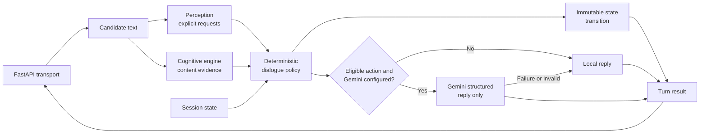

# Multimodal Reasoning Companion

A CPU-first adaptive interview-practice assistant built as an AI systems portfolio project. The project separates observable input processing, internal state, dialogue policy, and response generation so each decision can be tested without relying on one large model.

The current milestone is a **stateless FastAPI text service with optional Gemini structured reply generation**. Perception, state updates, and dialogue actions remain deterministic and fully testable offline; audio, vision, and React are not implemented yet.

## Research question

> Compared with a transcript-only assistant, can speech-activity and optional visual observations later improve when the assistant waits, offers a hint, or asks a follow-up without making unsupported claims about the user's mental state?

The text baseline establishes the control condition for that future comparison.

## Architecture



| Layer | Responsibility | Must not do |
|---|---|---|
| `perception` | Detect explicit requests for a hint, thinking time, or stopping | Infer emotion or choose the final action |
| `cognitive` | Extract narrow content evidence and apply state transitions | Generate dialogue or call an LLM |
| `reasoning` | Apply one documented policy, render local replies, and optionally request one structured Gemini reply | Allow Gemini to change an action, reason, or state |
| `service` | Orchestrate one turn in a fixed order and expose reply source/fallback metadata | Persist transcripts or duplicate policy rules |
| `api` | Validate HTTP requests and delegate one turn to `InterviewService` | Store sessions, duplicate policy, or expose internal errors |
| `eval` | Exercise the domain service directly in local mode | Start FastAPI, a browser, or Gemini |

Control precedence is:

```text
ended session > stop > thinking time > hint > missing input
> class-level follow-up > evaluation follow-up > continue
```

## Current behavior

The baseline supports six actions:

- `offer_hint`
- `wait`
- `ask_followup`
- `end_session`
- `continue_interview`
- `request_input`

Every turn returns the extracted signals, content evidence, selected action and reason, updated session state, reply, `reply_source`, and optional `fallback_reason`. `SessionState` contains counters and control state only; it does not retain candidate text. `wait`, `end_session`, and `request_input` are always rendered locally. Only `offer_hint`, `ask_followup`, and `continue_interview` are eligible for Gemini.

## Quickstart

Use official CPython 3.11 or newer. On Windows:

```powershell
py -3.14 -m venv .venv
.venv\Scripts\python -m pip install -r requirements-dev.txt
.venv\Scripts\python -m pytest -q
.venv\Scripts\python -m eval.run_cases
.venv\Scripts\python -m uvicorn backend.app.main:app --reload
```

On macOS or Linux:

```bash
python3 -m venv .venv
.venv/bin/python -m pip install -r requirements-dev.txt
.venv/bin/python -m pytest -q
.venv/bin/python -m eval.run_cases
.venv/bin/python -m uvicorn backend.app.main:app --reload
```

### Optional Gemini replies

The project uses the official `google-genai` SDK and defaults to the current stable low-latency model `gemini-3.8-flash`. Copy `.env.example` as a reference, then set variables in the process environment; the project does not silently load `.env` files.

```powershell
$env:GEMINI_API_KEY = "your-key"
$env:GEMINI_MODEL = "gemini-3.8-flash"
$env:GEMINI_TIMEOUT_SECONDS = "8"
```

The FastAPI composition root reads these variables when the server starts and constructs `InterviewService` once. No key keeps the API in local response mode.

An absent or blank key keeps local mode. Invalid timeout configuration fails at construction only when a key is present. Timeout, SDK error, malformed structured output, or invalid reply uses the exact local response and returns `reply_source="local_fallback"` with a machine-readable reason. There are no application-level retries.

Run every command from the repository root.

## Text API

The API is stateless. Clients send the current `SessionState` with every turn and receive the updated state in the response.

| Method | Path | Behavior |
|---|---|---|
| `GET` | `/health` | Returns `{\"status\":\"ok\"}` without invoking the model |
| `POST` | `/v1/interview/turn` | Runs one deterministic interview turn |
| `GET` | `/docs` | Interactive OpenAPI documentation |

Example request:

```bash
curl -X POST http://127.0.0.1:8000/v1/interview/turn \
  -H \"Content-Type: application/json\" \
  -d '{
    \"candidate_input\": \"I built a classifier for support tickets.\",
    \"state\": {\"session_id\": \"demo-session\"}
  }'
```

The response includes observable evidence, the local policy decision, updated state, reply, `reply_source`, and optional `fallback_reason`. Schema errors return HTTP `422`. Gemini failures still return HTTP `200` with the exact local reply and `reply_source=\"local_fallback\"`.

Browser access is restricted to the local Vite origins `http://localhost:5173` and `http://127.0.0.1:5173`.

## Evaluation

`eval/cases.json` contains five initial interview scenarios:

1. explicit hint request;
2. explicit request for thinking time;
3. project description without evaluation evidence;
4. macro-F1 with class-imbalance rationale but no class-level result;
5. explicit request to end the session.

The runner creates a fresh session for each case and compares `action`, `reason`, and `followup_topic`. Human-facing `reply_criteria` remain in the fixture for later structured-output evaluation.

A successful run prints:

```text
PASS request_hint
PASS request_thinking_time
PASS project_without_evaluation
PASS metric_with_rationale
PASS request_end_session
Summary: 5 passed, 0 failed
```

It writes `eval/results/latest.json` with this shape:

```json
{
  "schema_version": "eval-v1",
  "summary": {
    "total": 5,
    "passed": 5,
    "failed": 0
  },
  "cases": [
    {
      "id": "request_hint",
      "expected": {
        "action": "offer_hint",
        "reason": "explicit_hint_request",
        "followup_topic": "none"
      },
      "actual": {
        "action": "offer_hint",
        "reason": "explicit_hint_request",
        "followup_topic": "none"
      },
      "reply": "Start by naming the metric you used and why it matched the problem.",
      "passed": true
    }
  ]
}
```

The five cases are a smoke evaluation, not evidence of robustness, scientific validity, multilingual performance, or generalization.

## Privacy and scientific boundaries

- Candidate text is processed in memory and is not stored in `SessionState` or default logs.
- Gemini receives candidate text only when an API key is configured, the generator is explicitly injected, and the selected action is eligible. Review Google's data handling terms before using real interview content.
- Logs contain reply source and fallback reason only, not candidate text, prompts, response bodies, API keys, or exception messages.
- Raw audio and video are not implemented or persisted.
- Microphone and camera capture will require explicit consent when those modalities are introduced.
- Missing sensor data will be represented as unavailable, never as a neutral expression or state.
- Text heuristics and future facial blendshapes do **not** measure stress, focus, mood, honesty, personality, competence, or hiring suitability.
- Vision has not been implemented. It remains an optional experiment that must demonstrate measurable value before inclusion.

Gemini generates wording only. Local policy retains ownership of `action`, `reason`, `followup_topic`, and all state transitions; control actions remain local even when Gemini is configured.
